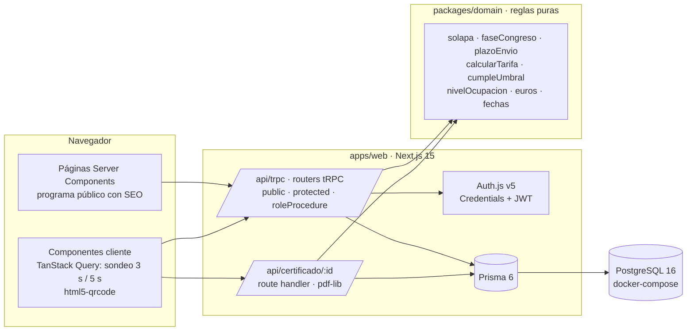
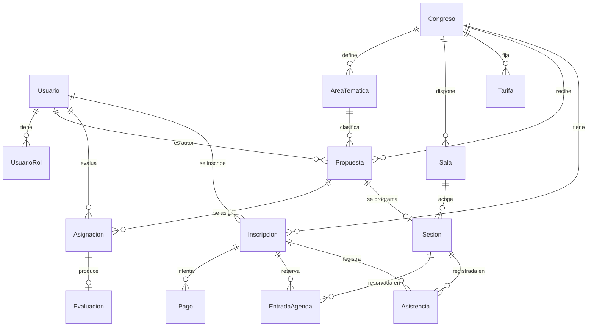
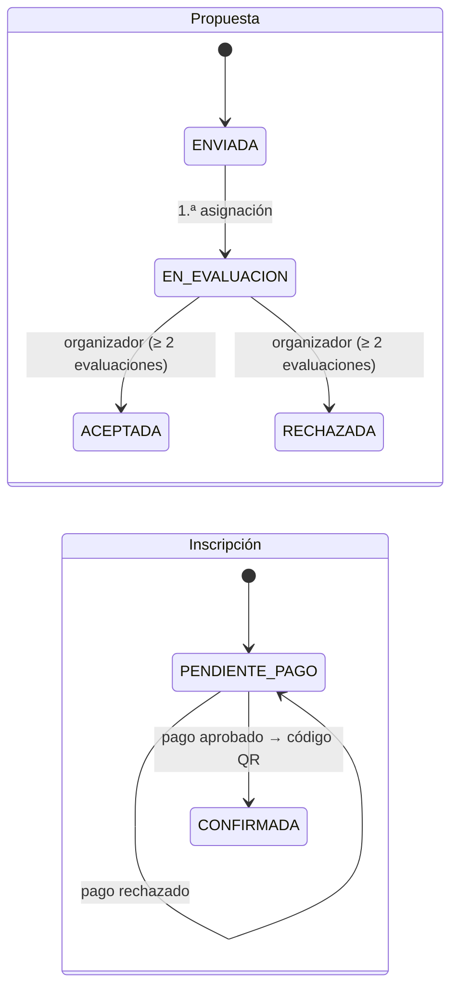
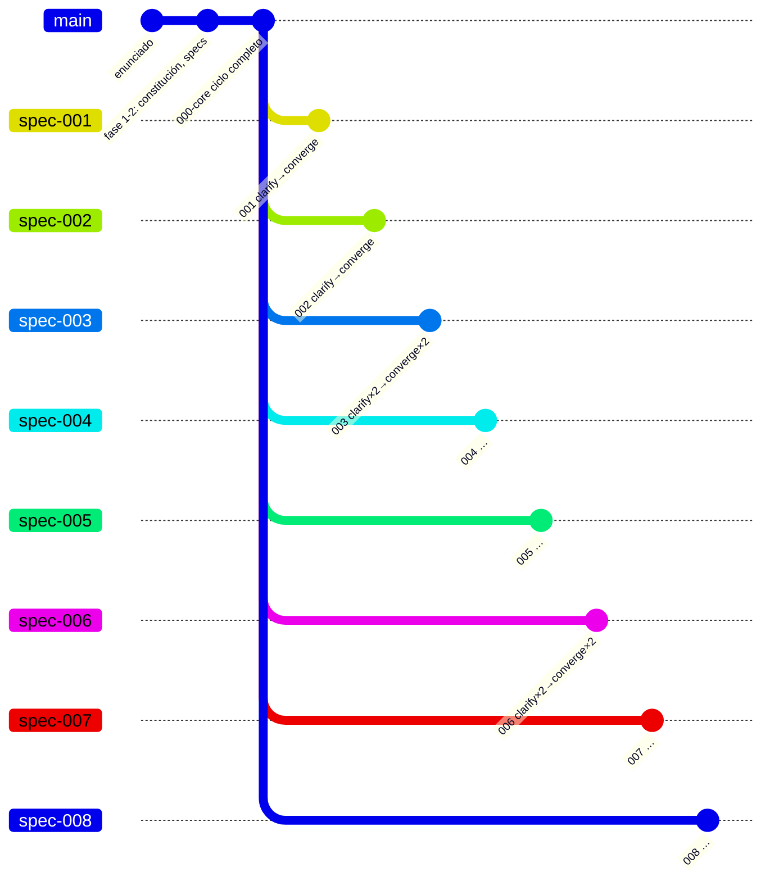

# Memoria del proyecto · Congresalia

**SI-19 · Gestión de Eventos y Congresos**

| | |
|---|---|
| Asignatura | Ingeniería Web · Universidad de Alicante · curso 2026-27 · Parte I (Spec-Driven Development) |
| Grupo | G16 · un integrante |
| Autor | **Yangfeng Liu** |
| Fecha | 3 de noviembre de 2026 |
| Metodología | Spec-Driven Development con GitHub Spec Kit 1.2.4 |
| Pila | Next.js 15 (App Router) · tRPC 11 · Prisma 6 · PostgreSQL 16 · shadcn/ui sobre Tailwind CSS 4 · TypeScript 5 |

## Resumen

Congresalia es una aplicación web para organizar congresos científicos y profesionales de principio a fin. La usan:

- los **ponentes**, que envían propuestas;
- el **comité científico**, que las evalúa de forma anónima;
- el **organizador**, que monta el programa público y sigue en un panel las inscripciones, los ingresos y la ocupación;
- los **asistentes**, que se inscriben, pagan, construyen su agenda y descargan su certificado;
- el **personal de acreditación**, que controla con un QR el acceso a cada sala.

El proyecto se ha desarrollado entero con Spec Kit. Hay una especificación común (`000-core`) y ocho especificaciones, una por historia de usuario. Cada una ha pasado el ciclo *specify → clarify → plan → tasks → analyze → implement → converge*, y todos los informes se guardan en el repositorio como evidencia. **Resultado**: las 8 historias están implementadas y convergidas, cada una en su rama. Las reglas de negocio se validan en el servidor y están cubiertas por unas 250 pruebas automáticas (unitarias, de integración y e2e), todas en verde. Quedan abiertas solo 4 mediciones de tiempo con usuarios reales y la integración de las ramas en `main`.

## URL del repositorio en GitHub

**<https://github.com/onewhitethreee/iw-p1>**

- `main`: base común (`specs/000-core`, esquema de datos, autenticación, roles, datos de ejemplo) y documentación.
- `spec-001` … `spec-008`: una rama por historia de usuario, con su especificación, sus informes y su código.

---

## 1. Introducción

### 1.1 Contexto

Un congreso reúne cientos de personas durante varios días alrededor de un programa de ponencias. Organizarlo supone coordinar fases que suelen gestionarse con herramientas separadas: hojas de cálculo, formularios, correo o pasarelas de pago. Las fases son:

- la llamada a comunicaciones;
- la revisión por el comité científico;
- el montaje del programa en salas y horarios;
- la inscripción y el cobro;
- el control de acceso;
- la acreditación de las horas de formación.

La narrativa SI-19 (`requisito/SI-19-eventos-congresos-descripcion-narrativa.pdf`, resumida en [descripcion-sistema.md](descripcion-sistema.md)) describe ese proceso completo.

### 1.2 Problema que resuelve

- **Información dispersa y reglas que se aplican a mano.** Ejemplos: el plazo de envío, el anonimato de la revisión, que un ponente no tenga dos charlas a la vez, que una sala no se llene por encima de su aforo, o que el certificado solo se emita con un 80 % de asistencia.
- **Falta de datos en tiempo real.** Sin ellos, el organizador no sabe qué sesiones van llenas ni puede reaccionar a tiempo cambiándolas de sala.
- **Programa público poco visible.** Si se renderiza en el cliente, los buscadores no lo indexan.

### 1.3 Objetivos

1. Cubrir las **8 historias de usuario** de la narrativa (HU-01 … HU-08) con criterios de aceptación comprobables.
2. Aplicar **todas las reglas de negocio en el servidor**: ocultar un botón nunca basta (Constitución IV).
3. Garantizar la **concurrencia**: ni el aforo ni los solapamientos pueden saltarse aunque varias personas actúen a la vez.
4. Publicar el programa con **renderizado en servidor y SEO** (objetivo Lighthouse SEO ≥ 90).
5. Seguir de forma estricta la metodología **SDD con Spec Kit** y dejar trazabilidad desde la historia hasta la prueba.

---

## 2. Análisis

> Esta sección sale casi directamente de los `spec.md`. La versión vigente de cada historia, con todos sus escenarios, está en su rama (ver [Anexo B](#anexo-b-especificaciones-completas)).

### 2.1 Actores y roles

| Actor | Rol en el sistema | Qué hace |
|-------|-------------------|----------|
| Visitante | — (sin sesión) | Consulta congresos y el programa publicado |
| Ponente | `PONENTE` | Envía propuestas y consulta su estado (HU-01) |
| Miembro del comité | `COMITE` | Evalúa de forma anónima las propuestas asignadas (HU-02) |
| Organizador | `ORGANIZADOR` | Asigna evaluadores, decide, monta y publica el programa, consulta el panel (HU-02, HU-03, HU-08) |
| Asistente | `ASISTENTE` | Se inscribe y paga, construye su agenda y descarga su certificado (HU-04, HU-05, HU-07) |
| Personal de acreditación | `ACREDITACION` | Escanea el QR en la puerta de cada sala (HU-06) |

Reglas sobre los roles:
- Una cuenta puede tener **varios roles** (acuerdo A8).
- Cualquiera puede registrarse como ponente o asistente, y añadirse después el otro de esos dos roles (000-core FR-003a).
- `ORGANIZADOR`, `COMITE` y `ACREDITACION` solo los asigna un organizador.
- Los roles se **releen de la base de datos en cada petición**, así que un rol retirado deja de valer aunque la sesión siga abierta.

### 2.2 Historias de usuario

| HU | Como… | quiero… | para… | Spec |
|----|-------|---------|-------|------|
| HU-01 | ponente | enviar una propuesta con resumen y área temática | que el comité la valore | [001](https://github.com/onewhitethreee/iw-p1/tree/spec-001/specs/001-enviar-propuesta) |
| HU-02 | miembro del comité | evaluar de forma anónima las propuestas asignadas | seleccionar las mejores ponencias | [002](https://github.com/onewhitethreee/iw-p1/tree/spec-002/specs/002-evaluar-propuestas) |
| HU-03 | organizador | asignar cada ponencia aceptada a sala y horario y publicar el programa | que asistentes y público lo consulten | [003](https://github.com/onewhitethreee/iw-p1/tree/spec-003/specs/003-programa-congreso) |
| HU-04 | asistente | inscribirme eligiendo mi tipo de entrada y pagarla | asistir al congreso | [004](https://github.com/onewhitethreee/iw-p1/tree/spec-004/specs/004-inscripcion-pago) |
| HU-05 | asistente inscrito | añadir sesiones a mi agenda | organizar mi congreso | [005](https://github.com/onewhitethreee/iw-p1/tree/spec-005/specs/005-agenda-personal) |
| HU-06 | personal de acreditación | escanear el QR a la entrada de la sala | controlar el aforo y registrar la asistencia real | [006](https://github.com/onewhitethreee/iw-p1/tree/spec-006/specs/006-acceso-qr) |
| HU-07 | asistente | descargar un certificado de asistencia | justificar mis horas de formación | [007](https://github.com/onewhitethreee/iw-p1/tree/spec-007/specs/007-certificado-asistencia) |
| HU-08 | organizador | un panel con inscripciones, ingresos y ocupación en tiempo real | tomar decisiones sobre la marcha | [008](https://github.com/onewhitethreee/iw-p1/tree/spec-008/specs/008-panel-tiempo-real) |

Cada historia tiene escenarios «Dado… Cuando… Entonces…». Hay al menos uno habitual, uno de error o límite y uno de permisos o estado (Constitución III).

### 2.3 Requisitos funcionales

**Comunes (000-core)**. Recogen los acuerdos A1–A10 de [agrupamiento.md](agrupamiento.md):

| Requisito | Regla |
|-----------|-------|
| FR-001…FR-004 | Registro con correo único y contraseña de 8 caracteres o más; cinco roles; toda operación protegida comprueba el rol en el servidor |
| FR-005 / FR-005a | Congreso con slug, sede, zona horaria y plazos; los días límite son días completos en la zona del congreso (de 00:00:00 a 23:59:59) |
| FR-007 | Fase deducida de las fechas: llamada abierta, en preparación, en curso o finalizado |
| FR-010 (A1) | `ENVIADA` → `EN_EVALUACION` → `ACEPTADA` \| `RECHAZADA`; decide el organizador y solo con 2 evaluaciones o más |
| FR-012 (A3) | Puntuación entera de 1 a 10 y comentario obligatorio |
| FR-013 | Anonimato: nada de lo que recibe un evaluador incluye datos del autor |
| FR-014 (A7) | `[inicioA, finA)` y `[inicioB, finB)` se solapan si `inicioA < finB` y `inicioB < finA` |
| FR-015 (A6) | Aforo de una sesión = aforo de su sala; ni las reservas ni las asistencias pueden superarlo |
| FR-016 (A4) | Tarifa según tipo de asistente y fecha de creación (temprana o general); queda fijada en la inscripción |
| FR-017/018 (A5) | `PENDIENTE_PAGO` → `CONFIRMADA` con pago simulado; solo la inscripción confirmada da QR, agenda y certificado |
| FR-019 | Certificado: asistencias a sesiones de la agenda / sesiones de la agenda ≥ 80 %, con el congreso finalizado |
| FR-020 (A9) | El panel se refresca solo cada 5 s o menos |
| FR-021 | Español de España e importes en euros (por ejemplo, «1.250,00 €») |
| FR-022 | Datos de ejemplo reproducibles con tres congresos en fases distintas |

**Por historia** (resumen; el detalle está en cada `spec.md`):

| Spec | Requisitos clave |
|------|------------------|
| 001 | Enviar solo dentro del plazo y con un área del congreso; la propuesta enviada es inmutable; el ponente ve solo el estado, nunca puntuaciones ni evaluadores |
| 002 | El organizador asigna evaluadores con rol comité, nunca al autor ni dos veces al mismo; el evaluador ve solo sus asignadas, sin autor; la evaluación se puede modificar hasta que se decide; para decidir hacen falta 2 evaluaciones o más; las asignaciones son permanentes |
| 003 | Solo se programan propuestas aceptadas; sin solapes de ponente ni de sala; dentro de las fechas y en el mismo día; un congreso finalizado bloquea el programa; una sesión empezada solo puede cambiar de sala; programa público con SSR, SEO, sitemap y robots |
| 004 | Precio vigente visible; importe calculado en el servidor y fijado; una inscripción por congreso; pasarela simulada (la tarjeta de prueba `4000 0000 0000 0002` se rechaza); QR único al confirmar; no se guardan datos de tarjeta |
| 005 | Agenda solo con inscripción confirmada; sesiones publicadas y no empezadas; sin solapes; sin superar el aforo, también con peticiones simultáneas; se puede quitar hasta que empiece; aviso si un cambio posterior del programa crea un solape |
| 006 | Solo el rol `ACREDITACION`; código existente, confirmado y del mismo congreso; ventana desde 30 min antes del inicio hasta el fin; «Ya registrado» sin consumir aforo; quien reservó tiene la plaza garantizada; el aforo se respeta con varias puertas a la vez |
| 007 | Certificado disponible solo con el congreso finalizado y un 80 % o más (comparación exacta); porcentaje mostrado truncado a entero; PDF con nombre, congreso, fechas, sede, sesiones y horas; solo el titular puede descargarlo |
| 008 | Solo el organizador; inscripciones e ingresos (pagos aprobados) con desglose por tipo × tarifa; ocupación por sesión = máx(reservas, asistencias) / aforo, con aviso a partir del 90 % y del 100 %; refresco cada 5 s; cambio de sala a una libre con aforo suficiente |

### 2.4 Requisitos no funcionales

| Tipo | Requisito | Origen |
|------|-----------|--------|
| Seguridad | Reglas y permisos en el servidor (SC-001 de 000-core: 100 % de las reglas también ante peticiones directas); contraseñas con bcrypt; secretos en variables de entorno | Constitución IV y VII |
| Privacidad | Anonimato del autor ante el comité; el panel solo muestra agregados; no se guardan tarjetas; el certificado solo lo obtiene su titular | 002 FR-005, 004 FR-008, 007 FR-005 |
| Concurrencia | 0 sesiones con más reservas o asistencias que aforo y 0 solapes, también con peticiones simultáneas | 003 SC-001, 005 SC-002, 006 SC-002 |
| Rendimiento | Escaneo en menos de 1 s; PDF en menos de 3 s; panel en menos de 2 s con 1.000 inscripciones y 50 sesiones; cambios visibles en el panel en 5 s o menos | 006 SC-001, 007 SC-002, 008 SC-001/004 |
| SEO | HTML inicial con todas las sesiones; Lighthouse SEO ≥ 90 | 003 SC-002/003 |
| Usabilidad | Registro en menos de 1 min; propuesta en menos de 3 min; evaluación en menos de 2 min; programar en menos de 1 min; inscribirse y pagar en menos de 3 min; agenda con un clic | SC de cada spec |
| Localización | Español de España, euros y fechas en la zona horaria del congreso | Constitución VI |

---

## 3. Diseño

> Sale de [specs/000-core/plan.md](../specs/000-core/plan.md), [research.md](../specs/000-core/research.md), [data-model.md](../specs/000-core/data-model.md), la [constitución](../.specify/memory/constitution.md) y los `plan.md` de cada spec.

### 3.1 Principios de la constitución (1.1.0)

| Principio | Efecto en el diseño |
|-----------|---------------------|
| I. Simplicidad ante todo | Sondeo en lugar de WebSockets; pago simulado; PDF con fuentes estándar |
| II. Cero alcance fantasma | Nada fuera de las specs (por ejemplo, no se editan ni retiran propuestas, ni hay modo sin conexión) |
| III. Verificable sin leer código | Escenarios «Dado/Cuando/Entonces» con caso habitual, de error y de permisos |
| IV. Reglas en el servidor (no negociable) | Toda regla vive en un procedimiento tRPC o en `packages/domain` |
| V. Base común en 000-core | Ninguna spec redefine entidades; el contrato y el modelo de 000-core se actualizan primero |
| VI. Español y euro | Formato con `Intl` (`es-ES`, `EUR`) y la zona horaria del congreso |
| VII. Datos personales | Anonimato, sin datos de tarjeta, `.env.example` sin secretos |

### 3.2 Arquitectura: monorepo con `apps/` y `packages/`



- **`apps/web`**: la aplicación Next.js. Contiene las páginas por zona (`ponente/`, `comite/`, `organizador/`, `area-personal/`, `acreditacion/`, `congresos/`), los routers tRPC (uno por spec), Prisma y las pruebas.
- **`packages/domain`**: reglas de negocio puras, sin acceso a datos. Se prueban con pruebas unitarias rápidas y las reutiliza el servidor (research R1).

### 3.3 Modelo de datos

Hay **una sola fuente de verdad** compartida por las 8 specs: [data-model.md](../specs/000-core/data-model.md) y `apps/web/prisma/schema.prisma`. Ninguna spec ha añadido entidades ni migraciones.



Convenciones e invariantes:
- Identificadores `cuid`.
- Fechas en `timestamptz` (UTC) y mostradas en la zona del congreso.
- **Importes en céntimos (`Int`)**.
- Unicidad garantizada por la base de datos:
  - una inscripción por usuario y congreso;
  - una evaluación por asignación;
  - una entrada de agenda y una asistencia por inscripción y sesión;
  - un código de acreditación único.
- Restricciones `CHECK` en una migración SQL: orden de las fechas del congreso, `aforo > 0`, importes coherentes y puntuación entre 1 y 10.

**Estados**:



### 3.4 Contrato de la API

Hay un router tRPC por spec, descrito en [contracts/trpc-api.md](../specs/000-core/contracts/trpc-api.md) y detallado en el `contracts/` de cada spec:

| Router | Spec |
|--------|------|
| `auth`, `congreso` | 000-core |
| `propuesta` | 001 |
| `evaluacion` | 002 |
| `programa` | 003 |
| `inscripcion` | 004 |
| `agenda` | 005 |
| `acreditacion` | 006 |
| `certificado` + `GET /api/certificado/[congresoId]` | 007 |
| `panel` | 008 |

Los errores siguen un código común: `UNAUTHORIZED`, `FORBIDDEN`, `NOT_FOUND`, `BAD_REQUEST` y `CONFLICT`. El mensaje viene en español y listo para mostrar. Los rechazos esperados en la puerta (spec-006) se devuelven como respuesta normal (`RECHAZADO` con el motivo), no como error.

### 3.5 Decisiones técnicas y por qué

| # | Decisión | Por qué | Alternativa descartada |
|---|----------|---------|------------------------|
| R1 | Monorepo pnpm `apps/web` + `packages/domain` | Reglas puras, probadas aparte y reutilizables | Una sola app (mezcla reglas y datos) |
| R2 | Auth.js v5 con Credentials y JWT; roles releídos de la BD en cada petición | Integración con App Router; retirar un rol tiene efecto inmediato | Sesiones propias, OAuth |
| R3 | `roleProcedure(...roles)` en tRPC | Protege también las llamadas directas a la API | Middleware por ruta (no protege la API) |
| R4 | Transacciones con `SELECT … FOR UPDATE` sobre la fila afectada (sesión, inscripción o sala) | Aforo y solapes correctos con peticiones simultáneas | `Serializable` con reintentos; restricción `btree_gist` (solo cubre salas) |
| R5 | Sondeo con TanStack Query: 5 s en el panel, 3 s en la puerta | Sencillo y suficiente para «tiempo real» (A9) | SSE o WebSockets (servidor con estado) |
| R6 | Server Components + `generateMetadata`, JSON-LD `Event`, `sitemap.ts` y `robots.ts` | SEO y HTML inicial completo | Renderizado en cliente |
| R7 | Código de acreditación UUID v4, QR con `qrcode` y lector `html5-qrcode` más campo manual | No adivinable; funciona en el móvil y sin cámara | QR firmado con JWT (innecesario: se valida contra la BD) |
| R8 | PDF en el servidor con `pdf-lib` | Fichero descargable sin navegador en el servidor | HTML imprimible, Puppeteer |
| R9 | Céntimos enteros y `Intl` | Exactitud al céntimo (008 SC-002) | `Decimal` |
| R10 | Vitest (unitarias + integración con `createCaller`) y Playwright | `createCaller` demuestra que las reglas se cumplen saltándose la interfaz | Solo e2e (lento y menos preciso) |
| R12 | Pasarela de pago simulada con una tarjeta que se rechaza | Permite demostrar el caso de error sin datos reales | Pasarela real (fuera de alcance) |

Decisiones relevantes de las specs:

| Spec | Decisión | Motivo |
|------|----------|--------|
| 002 | Consultas del comité con un `select` explícito (`SELECT_ANONIMO`) que nunca incluye `autorId` | Anonimato comprobable con pruebas sobre cada respuesta |
| 003 | Las horas se introducen en la zona del congreso como «AAAA-MM-DD + HH:mm» | Evitar errores de zona horaria (clarify P2) |
| 006 | Orden de comprobación: código → congreso → confirmada → ventana → ya registrado → aforo → plazas sin reservar | Quien sale y vuelve a entrar no es rechazado con la sala llena |
| 007 | Una sola función `calcularCertificado()` para la pantalla y para la descarga | La pantalla y el PDF no pueden discrepar (FR-005) |
| 008 | `panel.cambiarSala` propio con las reglas de spec-003 aplicables y bloqueo de la sala destino | Permite probar spec-008 sin depender de la rama spec-003 |

---

## 4. Implementación

### 4.1 Pila tecnológica

| Capa | Tecnología |
|------|------------|
| Lenguaje | TypeScript 5.9, Node.js 22 |
| Framework | Next.js 15.5 (App Router, Server Components, route handlers), React 19 |
| API | tRPC 11 + `@trpc/tanstack-react-query`, superjson, zod 3 |
| Datos | Prisma 6.19 sobre PostgreSQL 16 (Docker) |
| Autenticación | Auth.js (`next-auth` 5 beta), bcryptjs |
| Interfaz | shadcn/ui (Radix) sobre Tailwind CSS 4, lucide-react, react-hook-form |
| Específicas | `qrcode` (QR), `html5-qrcode` (cámara), `pdf-lib` (certificado) |
| Pruebas | Vitest 3, Playwright 1.64, Lighthouse 12 |
| Herramientas | pnpm 10 (workspaces), ESLint, GitHub Spec Kit 1.2.4 |

### 4.2 Estructura del repositorio

```text
iw-p1/
├── .specify/                 Spec Kit: constitución (memory/), plantillas y scripts
├── .claude/skills/           Comandos de Spec Kit (speckit-*)
├── docs/                     Narrativa, historias, agrupamiento, esta memoria
├── requisito/                Enunciado, guía y narrativa (PDF)
├── specs/
│   ├── 000-core/             Base común: spec, plan, research, data-model, contracts, quickstart, informes
│   └── 00X-…/                spec.md, plan.md, research.md, data-model.md, contracts/, quickstart.md,
│                             tasks.md, checklists/, informes/ (clarify, analyze, converge, verificación)
├── apps/web/
│   ├── prisma/               schema.prisma, migraciones, seed.ts
│   ├── src/app/              Páginas por zona + api/trpc + api/certificado
│   ├── src/server/           auth, guards, usuarios, api/trpc.ts, api/root.ts, api/routers/*
│   ├── src/components/ui/    shadcn/ui
│   └── tests/                integration/<spec>/ y e2e/<spec>.spec.ts
├── packages/domain/          src/ (reglas puras) y tests/
├── docker-compose.yml        PostgreSQL 16 (BD de desarrollo y de pruebas)
└── pnpm-workspace.yaml
```

### 4.3 Partes más relevantes del código

**Autorización en el servidor** (`apps/web/src/server/api/trpc.ts`). Cada procedimiento declara qué roles admite, y el contexto carga el usuario de la base de datos:

```ts
export function roleProcedure(...roles: Rol[]) {
  return protectedProcedure.use(({ ctx, next }) => {
    if (!ctx.usuario.roles.some((r) => roles.includes(r))) {
      throw new TRPCError({ code: "FORBIDDEN", message: "No tienes permiso para realizar esta acción" });
    }
    return next({ ctx });
  });
}
```

El contexto también incluye un reloj `ctx.ahora()` que se puede sustituir en las pruebas. Así se prueban plazos, ventanas de acceso y congresos finalizados sin esperar.

**Reglas puras** (`packages/domain`). Ejemplo, el solapamiento A7, que reutilizan el programa, la agenda y el panel:

```ts
export function solapa(a: Intervalo, b: Intervalo): boolean {
  return a.inicio.getTime() < b.fin.getTime() && b.inicio.getTime() < a.fin.getTime();
}
```

Otras reglas: `plazoEnvio`, `faseCongreso`, `calcularTarifa`, `cumpleUmbral` (`asistidas × 100 ≥ 80 × total`, sin redondeo), `horasCertificadas`, `nivelOcupacion`, `euros()` y las funciones de días completos en la zona horaria (`inicioDeDia`, `finDeDia`, `instanteLocal`).

**Concurrencia** (patrón común de spec-002, 003, 005, 006 y 008). Se bloquea la fila antes de contar e insertar. Ejemplo de la puerta (spec-006):

```ts
return ctx.db.$transaction(async (tx) => {
  const bloqueo = await tx.$queryRaw`SELECT id FROM "Sesion" WHERE id = ${input.sesionId} FOR UPDATE`;
  // … código → congreso → confirmada → ventana → ya registrado → aforo → plazas sin reservar
  await tx.asistencia.create({ data: { inscripcionId, sesionId, registradaPorId: ctx.usuario.id } });
});
```

Una prueba lanza 10 escaneos simultáneos para la última plaza y comprueba que solo se admite uno.

**Anonimato** (spec-002). Las consultas del comité usan un `select` explícito sin datos del autor (`SELECT_ANONIMO`), y las pruebas recorren cada respuesta buscando su id, nombre o correo.

**Programa público con SEO** (spec-003). Es un Server Component con `generateMetadata`, URL canónica, Open Graph, JSON-LD `Event` por congreso y por sesión, `sitemap.xml` y `robots.txt`. En borrador lleva `noindex`. Resultado de Lighthouse: **SEO 100 y accesibilidad 100**.

**Certificado** (spec-007). `calcularCertificado()` decide el estado: sin inscripción, no finalizado, agenda vacía, por debajo del umbral o disponible. La pantalla y el route handler usan esa misma función. El PDF se genera con `pdf-lib`; los caracteres que la fuente estándar no representa se sustituyen por equivalentes (Ł→L, ≥→>=) para que un nombre no latino nunca provoque un error 500.

**Panel** (spec-008). Los agregados se calculan en PostgreSQL: `groupBy` de las inscripciones y `SUM` de los pagos aprobados por tipo × tarifa. La interfaz es un componente cliente con `refetchInterval: 5000`, aviso «Sin actualizar desde hh:mm:ss» y cambio de sala con revalidación en el servidor.

### 4.4 Decisiones tomadas sobre la marcha

Salieron de `/speckit-clarify` (preguntas de la herramienta, respondidas con la opción recomendada), de `/speckit-analyze` (incoherencias entre artefactos) y de `/speckit-converge` (huecos entre el código y la spec):

| Spec | Decisión | Origen |
|------|----------|--------|
| 000-core | Los días límite son días completos en la zona del congreso; el usuario puede añadirse el rol ponente o asistente; el comité es global | clarify P1, P2, P4 |
| 000-core | Restricciones `CHECK` en la BD; errores de validación en español; página 404 propia | converge T042–T044, analyze D1 |
| 001 | La propuesta enviada no se edita ni se retira; sin límite de propuestas; el ponente solo ve el estado | clarify P1–P3 |
| 002 | Las asignaciones no se quitan; no hay nota mínima para decidir; bloqueo para la carrera entre evaluar y decidir | clarify P1–P2, analyze U1 |
| 003 | Congreso finalizado = programa bloqueado; sesión empezada = solo cambio de sala; horas en la zona del congreso; nada que cruce la medianoche | clarify P1–P3 (P3 por el hallazgo A1 de analyze) |
| 004 | Tipo e importe inmutables; inscripción posible hasta el fin del congreso; tarjeta de 16 dígitos con una de prueba que se rechaza | clarify P1–P3 |
| 005 | Si un cambio del programa crea un solape, la agenda lo marca sin quitar sesiones | clarify P1 |
| 006 | Sin exigir la agenda para entrar; ventana desde 30 min antes del inicio; **la reserva garantiza la plaza** | clarify P1–P2 y P3 (por el hallazgo H1 de analyze: la reserva no garantizaba la plaza) |
| 006 | Mensaje «Sin conexión» en español en lugar de «Failed to fetch» | converge T010 |
| 007 | Solo el titular descarga; porcentaje truncado a entero; PDF robusto ante caracteres no latinos | clarify P1–P2, converge T011 |
| 008 | Ocupación = máx(reservas, asistencias); aforo destino ≥ esa cifra; solo sesiones no terminadas; ejemplo del seed corregido | clarify P1–P3, analyze I1, converge T014 |
| Todas | **Revisar y actualizar el contrato de 000-core en cada `/speckit-plan`** | Lección de los hallazgos C1 (spec-003 y spec-004) y X1 (spec-002) |

---

## 5. Pruebas y validación

### 5.1 Estrategia

| Nivel | Herramienta | Qué cubre | Dónde |
|-------|-------------|-----------|-------|
| Unitarias | Vitest | Reglas puras: solapes, plazos, días completos y zonas horarias, tarifas, umbral del 80 %, horas, ocupación y formato | `packages/domain/tests/` |
| Integración | Vitest + `createCaller` contra PostgreSQL (`congresalia_test`, se vacía antes de cada prueba) | Cada procedimiento tRPC con su caso habitual, de error y de permisos; concurrencia con `Promise.all`; reloj simulado; carga (1.000 inscripciones) | `apps/web/tests/integration/<spec>/` |
| Extremo a extremo | Playwright contra `next start` con el seed recargado | Recorridos principales de cada historia en el navegador, incluido el refresco sin recargar y la red cortada | `apps/web/tests/e2e/<spec>.spec.ts` |
| SEO | Lighthouse 12 | Programa público (spec-003 SC-002) | `specs/003-…/informes/lighthouse.json` |
| Estática | ESLint (`--max-warnings 0`), `tsc --noEmit`, `next build` | Calidad y tipos | — |

Las pruebas se escriben **antes que el código** en cada `/speckit-implement`: primero se comprueba que fallan y después se implementa. Cada tarea de `tasks.md` está trazada a su FR o escenario.

### 5.2 Resultados

Resultado de la regresión completa de cada rama, tal como queda en su `informes/verificacion.md`:

| Rama | Dominio | Integración (base + spec) | E2E (base + spec) | Lint / tipos / build |
|------|---------|---------------------------|-------------------|----------------------|
| main (000-core) | 34/34 | 22/22 | 7/7 | ✔ |
| spec-001 | 34/34 | 36/36 (22 + 14) | 12/12 (7 + 5) | ✔ |
| spec-002 | 34/34 | 50/50 (22 + 28) | 14/14 (7 + 7) | ✔ |
| spec-003 | 38/38 | 44/44 (22 + 22) | 12/12 (7 + 5) | ✔ · Lighthouse SEO 100 |
| spec-004 | 34/34 | 38/38 (22 + 16) | 11/11 (7 + 4) | ✔ |
| spec-005 | 38/38 | 37/37 (22 + 15) | 10/10 (7 + 3) | ✔ |
| spec-006 | 34/34 | 38/38 (22 + 16) | 12/12 (7 + 5) | ✔ |
| spec-007 | 35/35 | 36/36 (22 + 14) | 11/11 (7 + 4) | ✔ |
| spec-008 | 37/37 | 38/38 (22 + 16) | 12/12 (7 + 5) | ✔ |

En total hay unas **42 pruebas unitarias distintas, 163 de integración y 45 e2e**, todas en verde. Algunas mediciones destacadas:

- **Escaneo** (spec-006): menos de 1 s en todas las ejecuciones.
- **Concurrencia**: 1 admitido de 10 escaneos simultáneos (spec-006) y 1 reserva de 20 peticiones por la última plaza (spec-005).
- **Certificado** (spec-007): PDF en decenas de milisegundos.
- **Panel con carga** (spec-008): menos de 2 s con 1.000 inscripciones y 50 sesiones.

### 5.3 Validación manual

Cada spec tiene un `quickstart.md` con los escenarios que se pueden comprobar en la aplicación usando los datos de ejemplo. El resultado de cada uno se registra en `informes/verificacion.md`, con las columnas *esperado / observado / resultado*. Hay 4 criterios que solo puede medir una persona y siguen **pendientes**, anotados como tareas de convergencia:

| Tarea | Criterio |
|-------|----------|
| spec-001 T015 | Enviar una propuesta en menos de 3 min |
| spec-002 T020 | Evaluar en menos de 2 min |
| spec-003 T022 | Programar una ponencia en menos de 1 min |
| spec-004 T013 | Inscribirse y pagar en menos de 3 min |

La revisión cruzada que pide el enunciado se ha sustituido, por ser un grupo de una persona, por una **autorrevisión diferida**. Se apoya en la lista de calidad `checklists/requirements.md` (17/17 en todas las specs) y en dos pasadas de `/speckit-analyze` por spec.

---

## 6. Despliegue y uso

### 6.1 Instalación y ejecución

Requisitos: Node.js 22, pnpm 10 y Docker.

```bash
git clone https://github.com/onewhitethreee/iw-p1.git && cd iw-p1
cp apps/web/.env.example apps/web/.env   # cambia AUTH_SECRET: openssl rand -base64 32
docker compose up -d                     # PostgreSQL 16 con la BD de desarrollo y la de pruebas
pnpm install
pnpm db:migrate                          # migraciones (incluye restricciones CHECK)
pnpm db:seed                             # datos de ejemplo con fechas relativas a hoy
pnpm dev                                 # http://localhost:3000
```

Variables (`apps/web/.env.example`):

| Variable | Uso |
|----------|-----|
| `DATABASE_URL` | BD de desarrollo |
| `DATABASE_URL_TEST` | BD de las pruebas de integración (se vacía en cada ejecución) |
| `AUTH_SECRET` | Secreto de Auth.js |
| `AUTH_URL` / `AUTH_TRUST_HOST` | URL pública y confianza en el host |

`docker-compose.yml` levanta `postgres:16` en el puerto 5432 con un volumen persistente y un script que crea la base `congresalia_test`.

Pruebas:

```bash
pnpm test                       # unitarias + integración
pnpm build && pnpm test:e2e     # Playwright (recarga el seed)
pnpm lint && pnpm typecheck
```

Producción: `pnpm build && pnpm start`, con las mismas variables apuntando a una PostgreSQL gestionada y `pnpm --filter web db:deploy` para aplicar las migraciones.

Mientras las ramas no estén integradas, cada historia se prueba con `git checkout spec-00X` y los mismos comandos.

### 6.2 Manual de usuario breve

Usuarios de ejemplo (contraseña `congreso123`, dominio `@congresalia.es`): `organizador`, `comite1`…`comite3`, `ponente1`, `ponente2`, `ponente.comite`, `asistente1`…`asistente5` y `acreditacion`.

Hay tres congresos de ejemplo:
- *Jornadas de Pediatría 2027*: llamada abierta.
- *Congreso de Innovación Educativa 2026*: en curso.
- *Simposio de Salud Digital 2026*: finalizado.

| Rol | Cómo se usa |
|-----|-------------|
| **Visitante** | En la portada están los congresos con su fase. En «Programa» se ven las sesiones publicadas, sin iniciar sesión. |
| **Ponente** | *Ponente → Nueva propuesta*: elige un congreso con la llamada abierta, escribe título, resumen y área, y pulsa «Enviar». En *Mis propuestas* ve el estado. |
| **Comité** | *Comité*: lista de propuestas asignadas, sin autor. Abre una y pon una puntuación de 1 a 10 y un comentario. Puedes cambiar la evaluación hasta que se decida. |
| **Organizador** | *Organizador → Propuestas*: asigna evaluadores y acepta o rechaza cuando hay 2 evaluaciones o más. *Programa*: programa las aceptadas en sala, día y hora (los solapes se rechazan con el nombre de la sesión en conflicto) y pulsa «Publicar». *Panel*: cifras, desglose y ocupación cada 5 s; usa «Solo completas o casi completas» y «Cambiar de sala». |
| **Asistente** | En la ficha del congreso, «Inscribirse»: elige el tipo de entrada, ve el precio vigente y paga en la pasarela simulada (la tarjeta `4000 0000 0000 0002` se rechaza). En *Área personal* están el QR, «Mi agenda» (añadir o quitar sesiones, con las plazas libres) y «Certificado» (porcentaje y PDF si llegas al 80 %). |
| **Acreditación** | *Acreditación*: elige el congreso y la sesión «Abierta ahora». Escanea con la cámara o escribe el código. El resultado se ve en verde (admitido), ámbar (ya registrado) o rojo (rechazado, con el motivo), junto a la ocupación «N / aforo». |

---

## 7. Planificación y seguimiento

### 7.1 Iteraciones

| Iteración | Contenido | Comandos de Spec Kit |
|-----------|-----------|----------------------|
| 0. Arranque | Lectura del enunciado, reparto ([agrupamiento.md](agrupamiento.md)), acuerdos A1–A10, constitución 1.0.0 → 1.1.0 | `speckit-constitution`, `speckit-specify` (×9) |
| 1. Base común | 000-core: clarify (4 preguntas), plan, tasks, analyze ×2, implement (T001–T041), converge ×2 (T042–T044) | ciclo completo |
| 2–9. Una historia por iteración, en el orden 001 → 008 | Para cada spec: clarify (2–3 preguntas, y una 2.ª sesión en 003 y 006 por hallazgos de analyze), plan con actualización del contrato de 000-core, tasks, analyze ×2 con registro de hallazgos, implement con las pruebas primero, converge, implement de las tareas de convergencia y converge-2 hasta *converged* | ciclo completo |

Resumen de hallazgos y su tratamiento:
- **Hallazgos de analyze** (todos cerrados): 4 CRITICAL, 4 HIGH, 11 MEDIUM y 23 LOW. Los CRITICAL fueron contratos no reflejados en 000-core y un caso de error que faltaba; los HIGH dieron lugar a nuevas sesiones de clarify o a correcciones de la spec.
- **Tareas de convergencia**: 12 en total.
  - **8 de código o documentación**: 7 ya implementadas (3 en 000-core, T042–T044; spec-003 T021, que documenta en el plan dos protecciones SEO; spec-006 T010; spec-007 T011; spec-008 T014) y 1 que se hará al integrar en `main` (spec-005 T011).
  - **4 de medición humana**, pendientes.

### 7.2 Ramas, issues y PR

- **Ramas**: `main` y una por spec (`spec-001` … `spec-008`), todas creadas desde `main`. Las dependencias entre ramas se anotan en el `tasks.md` de cada spec; por ejemplo, el enlace «Mi agenda» se hace al integrar. Para que cada historia se pudiera probar sola, en dos casos se copió sin cambios código de otra rama (`fechas.ts` de spec-003 en spec-005; el `global-setup` de los e2e de spec-002).
- **Issues**: no se han creado. El backlog vive en el `tasks.md` de cada spec, con identificadores, trazabilidad y estado. El comando `speckit-taskstoissues` aparece como obsoleto en Spec Kit 1.2.4 y no se usó.
- **Pull requests**: todavía no se han abierto. La integración de las ramas en `main` está pendiente (ver Conclusiones) y se hará mediante una PR por rama, en el orden de las dependencias.

### 7.3 Historial de commits

Hay unos **77 commits**, todos del 3 de noviembre de 2026:

| Rama | Commits |
|------|---------|
| `main` | 14 (enunciado, fase 1-2 y ciclo completo de 000-core) |
| `spec-001` | 7 |
| `spec-002` | 8 |
| `spec-003` | 10 |
| `spec-004` | 7 |
| `spec-005` | 7 |
| `spec-006` | 8 |
| `spec-007` | 7 |
| `spec-008` | 9 |

Cada commit corresponde a un paso del ciclo: `clarify`, `plan`, `tasks`, `analyze 1/2`, `implementar`, `converge-1/2`. Los commits los firma Yangfeng Liu, con dos excepciones: el commit inicial del enunciado (cuenta `onewhite`) y un commit de spec-008 que salió con la identidad por defecto de la herramienta. El trabajo se hizo con asistencia de IA (Claude Code), que ejecutó los comandos de Spec Kit; el integrante tomó las decisiones de alcance y revisó los artefactos.



---

## 8. Conclusiones

### 8.1 Qué se consiguió

- Las **8 historias de usuario implementadas**, cada una con su spec, su plan, sus tareas trazadas y sus pruebas. Cada spec terminó con converge en estado *converged*, salvo las mediciones humanas.
- **Reglas de negocio en el servidor**, comprobadas con pruebas que llaman directamente a la API: anonimato, plazos, mínimo de 2 evaluaciones, solapes, aforo con concurrencia, pago confirmado, 80 % de asistencia y permisos por rol.
- **Un único modelo de datos** para las 8 specs, sin migraciones adicionales, gracias a 000-core y al principio V.
- Programa público con **SEO 100 en Lighthouse**.
- **Evidencia completa del proceso**: cada clarify, analyze y converge guardado con su diff o su registro de hallazgos.

### 8.2 Problemas encontrados

| Problema | Cómo se resolvió |
|----------|------------------|
| Al principio no se ejecutaban de verdad los comandos de Spec Kit | Desde entonces se ejecuta el ciclo completo en cada spec y se guardan las salidas |
| Contratos compartidos desactualizados: una spec concretaba una firma y no la reflejaba en 000-core (C1 en 003 y 004, X1 en 002) | Corregidos, y regla nueva: revisar el contrato de 000-core en cada `/speckit-plan` |
| Incoherencias entre specs: la reserva de agenda no garantizaba la plaza en la puerta (006 H1); un caso límite imposible (007 I1); un ejemplo incompatible con el seed (008 I1) | Vuelta a clarify o corrección de la spec antes de implementar |
| Ramas independientes que necesitan código de otras | Copia idéntica del fichero necesario, o tarea anotada para la integración |
| Detalles de robustez detectados por converge: mensajes de red en inglés, PDF con caracteres no latinos | Tareas de convergencia con prueba primero |
| Entorno: PostgreSQL parado tras reinicios y tipos obsoletos en `.next` | Arranque del clúster antes de las pruebas y `rm -rf .next` al cambiar de rama |
| Grupo de una sola persona: sin revisión cruzada real | Autorrevisión diferida con la lista de calidad y dos pasadas de analyze |

### 8.3 Trabajo futuro

1. **Integrar las ramas en `main`** con una PR por spec, resolviendo los conflictos esperados (contrato de 000-core, índices de `organizador/` y `area-personal/`, `root.ts`). Después, hacer T011 de spec-005 y comprobar en pantalla el programa público tras un cambio de sala.
2. **Hacer las 4 mediciones humanas** (T015, T020, T022, T013) y registrarlas.
3. Revisar en conjunto, tras la integración, los bloqueos entre `programa` y `panel` hacia la misma sala.
4. Fuera del alcance de la versión 1 y solo si entran en una spec:
   - gestión de congresos desde la interfaz;
   - pasarela de pago real;
   - envío del certificado por correo y código de verificación;
   - exportación del panel;
   - notificaciones al ponente;
   - modo sin conexión en la puerta.
5. Despliegue en un servicio gestionado (por ejemplo, Vercel con PostgreSQL gestionado) con integración continua que ejecute lint, tipos y pruebas.

---

## Anexos

### Anexo A. Enlace al repositorio

- Repositorio: <https://github.com/onewhitethreee/iw-p1>
- Constitución: [.specify/memory/constitution.md](../.specify/memory/constitution.md)
- Narrativa: [descripcion-sistema.md](descripcion-sistema.md) · Historias: [historias-usuario.md](historias-usuario.md) · Reparto y acuerdos: [agrupamiento.md](agrupamiento.md)
- Enunciado y guía: [requisito/](../requisito/)

### Anexo B. Especificaciones completas

Cada carpeta contiene `spec.md`, `plan.md`, `research.md`, `data-model.md`, `contracts/`, `quickstart.md`, `tasks.md`, `checklists/requirements.md` e `informes/` (clarify con su diff, analyze-1 y analyze-2 con su registro, converge, verificación).

| Spec | Rama | Carpeta |
|------|------|---------|
| 000-core · base común | `main` | [specs/000-core](../specs/000-core/) |
| 001 · Enviar propuesta | `spec-001` | <https://github.com/onewhitethreee/iw-p1/tree/spec-001/specs/001-enviar-propuesta> |
| 002 · Evaluar propuestas | `spec-002` | <https://github.com/onewhitethreee/iw-p1/tree/spec-002/specs/002-evaluar-propuestas> |
| 003 · Programa del congreso | `spec-003` | <https://github.com/onewhitethreee/iw-p1/tree/spec-003/specs/003-programa-congreso> |
| 004 · Inscripción y pago | `spec-004` | <https://github.com/onewhitethreee/iw-p1/tree/spec-004/specs/004-inscripcion-pago> |
| 005 · Agenda personal | `spec-005` | <https://github.com/onewhitethreee/iw-p1/tree/spec-005/specs/005-agenda-personal> |
| 006 · Acceso con QR | `spec-006` | <https://github.com/onewhitethreee/iw-p1/tree/spec-006/specs/006-acceso-qr> |
| 007 · Certificado de asistencia | `spec-007` | <https://github.com/onewhitethreee/iw-p1/tree/spec-007/specs/007-certificado-asistencia> |
| 008 · Panel en tiempo real | `spec-008` | <https://github.com/onewhitethreee/iw-p1/tree/spec-008/specs/008-panel-tiempo-real> |

### Anexo C. Glosario

| Término | Significado |
|---------|-------------|
| **Acreditación** | Código único (UUID, mostrado como QR) que identifica a un asistente con inscripción confirmada |
| **Aforo** | Plazas de una sala; el aforo de una sesión es el de su sala (A6) |
| **Agenda** | Sesiones elegidas por un asistente; cada entrada reserva una plaza |
| **Área temática** | Clasificación de las propuestas dentro de un congreso |
| **Asistencia** | Registro de que un asistente entró en una sesión (escaneo en la puerta) |
| **Asignación** | Encargo de evaluar una propuesta a un miembro del comité |
| **Certificado** | PDF que acredita la asistencia y las horas de formación (80 % o más de la agenda) |
| **Constitución** | Principios no negociables del proyecto (`.specify/memory/constitution.md`) |
| **Fase del congreso** | Llamada abierta, en preparación, en curso o finalizado; se deduce de las fechas |
| **Ocupación** | En el panel, máx(reservas, asistencias) / aforo |
| **Propuesta** | Ponencia enviada por un ponente: título, resumen y área |
| **Sesión** | Ponencia aceptada programada en una sala y un horario |
| **Solapamiento** | Dos intervalos `[inicio, fin)` se solapan si `inicioA < finB` y `inicioB < finA` (A7) |
| **Tarifa temprana / general** | Precio por tipo de asistente según la fecha de inscripción (A4) |
| **SDD** | *Spec-Driven Development*: desarrollo guiado por especificaciones |
| **Spec Kit** | Herramienta de GitHub para SDD; comandos `specify`, `clarify`, `plan`, `tasks`, `analyze`, `implement`, `converge` |
| **clarify / analyze / converge** | Resolver ambigüedades de la spec / revisar la coherencia entre artefactos / contrastar el código con la spec y añadir tareas pendientes |
| **000-core** | Spec común con el plan, el modelo de datos y el contrato compartidos |
| **tRPC** | API con tipos de extremo a extremo entre el servidor y el cliente en TypeScript |
| **Prisma** | ORM tipado para PostgreSQL |
| **SSR / SEO** | Renderizado en el servidor / optimización para buscadores |
| **Seed** | Datos de ejemplo reproducibles (`pnpm db:seed`) |
