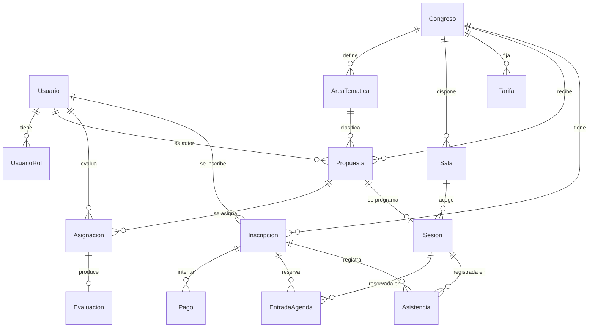

# Data Model: Congresalia (compartido por spec-001 … spec-008)

**Fecha**: 2026-11-03 · **Responsable**: Yangfeng Liu · Fuente única de verdad (Constitución V)

Convenciones: identificadores `cuid`; fechas `timestamptz` (UTC); importes en céntimos (`Int`); cada tabla
tiene `createdAt`/`updatedAt`. Los nombres de modelos y campos están en español para que coincidan con las specs.

## Diagrama



## Enumerados

| Enum | Valores |
|------|---------|
| `Rol` | `ORGANIZADOR`, `COMITE`, `PONENTE`, `ASISTENTE`, `ACREDITACION` |
| `EstadoPropuesta` | `ENVIADA`, `EN_EVALUACION`, `ACEPTADA`, `RECHAZADA` |
| `TipoAsistente` | `PROFESIONAL`, `SOCIO`, `ESTUDIANTE` |
| `EstadoInscripcion` | `PENDIENTE_PAGO`, `CONFIRMADA` |
| `ResultadoPago` | `APROBADO`, `RECHAZADO` |
| `EstadoPrograma` | `BORRADOR`, `PUBLICADO` |

## Entidades

### Usuario
| Campo | Tipo | Reglas |
|-------|------|--------|
| id | String | PK |
| nombre | String | 2–100 caracteres |
| email | String | único, en minúsculas |
| passwordHash | String | bcrypt; nunca se devuelve al cliente |

### UsuarioRol
`(usuarioId, rol)` clave primaria compuesta. Un usuario puede tener varios roles (A8). Clarify P2: el propio usuario puede crear su fila `PONENTE` o `ASISTENTE`; las demás solo un organizador. Clarify P4: `COMITE` es global (no depende del congreso).

### Congreso
| Campo | Tipo | Reglas |
|-------|------|--------|
| id, slug | String | `slug` único, en minúsculas y con guiones (URL pública) |
| nombre, descripcion, sede | String | obligatorios |
| zonaHoraria | String | IANA, por defecto `Europe/Madrid` |
| inicio, fin | DateTime | `inicio < fin` |
| envioAbre, envioCierra | DateTime | `envioAbre < envioCierra ≤ inicio`. Clarify P1: el organizador indica **días**; se guardan como instantes exclusivos: `envioAbre` = 00:00 del día de apertura y `envioCierra` = 00:00 del día **siguiente** al de cierre, ambos en la zona del congreso. Así el plazo `[envioAbre, envioCierra)` incluye todo el día de cierre. |
| limiteTemprana | DateTime | Clarify P1: 23:59:59.999 del día límite en la zona del congreso (inclusive, `creadaEn ≤ limiteTemprana`); `≤ inicio`. En pantalla se muestra solo el día. |
| estadoPrograma | EstadoPrograma | por defecto `BORRADOR` |
| publicadoEn | DateTime? | se fija al publicar |

Fase calculada (no se guarda): `LLAMADA_ABIERTA` si `envioAbre ≤ ahora < envioCierra`; `EN_CURSO` si `inicio ≤ ahora < fin`; `FINALIZADO` si `ahora ≥ fin`; si no, `EN_PREPARACION`.

### AreaTematica
`id`, `congresoId`, `nombre` (único dentro del congreso).

### Propuesta
| Campo | Tipo | Reglas |
|-------|------|--------|
| id | String | PK |
| congresoId | FK Congreso | |
| areaId | FK AreaTematica | debe pertenecer al mismo congreso |
| autorId | FK Usuario | rol `PONENTE`; **nunca se expone a evaluadores** |
| titulo | String | 5–200 caracteres |
| resumen | String | 100–3000 caracteres |
| estado | EstadoPropuesta | por defecto `ENVIADA` |
| enviadaEn | DateTime | momento del envío (servidor) |
| decididaEn | DateTime? | momento de aceptar o rechazar |

Transiciones (A1):

```text
ENVIADA --(se asigna el primer evaluador)--> EN_EVALUACION
EN_EVALUACION --(organizador acepta, ≥2 evaluaciones)--> ACEPTADA
EN_EVALUACION --(organizador rechaza, ≥2 evaluaciones)--> RECHAZADA
```
`ACEPTADA` y `RECHAZADA` son finales.

### Asignacion
`id`, `propuestaId`, `evaluadorId` (rol `COMITE`), `asignadaEn`. Único `(propuestaId, evaluadorId)`. `evaluadorId ≠ propuesta.autorId`.

### Evaluacion
`id`, `asignacionId` (único), `puntuacion` (Int 1–10), `comentarios` (String, 10–2000), `evaluadaEn`. No se puede modificar si la propuesta ya está decidida.

### Sala
`id`, `congresoId`, `nombre` (único dentro del congreso), `aforo` (Int > 0).

### Sesion
| Campo | Tipo | Reglas |
|-------|------|--------|
| id | String | PK |
| congresoId | FK Congreso | |
| propuestaId | FK Propuesta | única; la propuesta debe estar `ACEPTADA` |
| salaId | FK Sala | del mismo congreso |
| inicio, fin | DateTime | `inicio < fin`; dentro de `[congreso.inicio, congreso.fin]` |

Invariantes (A7, intervalo semiabierto):
- No hay dos sesiones en la misma sala que se solapen.
- No hay dos sesiones cuyas propuestas tengan el mismo autor y se solapen.

El **aforo de la sesión** es `sala.aforo` (A6). El ponente de la sesión es `propuesta.autor`.

### Tarifa
`id`, `congresoId`, `tipoAsistente`, `importeTempranoCent` (Int ≥ 0), `importeGeneralCent` (Int ≥ importe temprano). Única `(congresoId, tipoAsistente)`.

### Inscripcion
| Campo | Tipo | Reglas |
|-------|------|--------|
| id | String | PK |
| congresoId, usuarioId | FK | único `(congresoId, usuarioId)` |
| tipoAsistente | TipoAsistente | |
| tarifaAplicada | `TEMPRANA` \| `GENERAL` | según `creadaEn ≤ congreso.limiteTemprana` |
| importeCent | Int | fijado al crear la inscripción (A4) |
| estado | EstadoInscripcion | `PENDIENTE_PAGO` → `CONFIRMADA` |
| codigoAcreditacion | String? | UUID v4 único; se genera al confirmar |
| creadaEn, confirmadaEn | DateTime | |

### Pago
`id`, `inscripcionId`, `importeCent`, `resultado` (ResultadoPago), `referencia` (String), `fecha`. Una inscripción tiene como máximo un pago `APROBADO`.

### EntradaAgenda
`id`, `inscripcionId` (debe estar `CONFIRMADA`), `sesionId`, `anadidaEn`. Único `(inscripcionId, sesionId)`.
Invariantes: no se solapa con otra entrada de la misma inscripción; `count(EntradaAgenda de la sesión) ≤ sala.aforo`.

### Asistencia
`id`, `inscripcionId`, `sesionId`, `registradaEn`, `registradaPorId` (Usuario `ACREDITACION`). Único `(inscripcionId, sesionId)`.
Invariante: `count(Asistencia de la sesión) ≤ sala.aforo`.

## Valores derivados que usan varias specs

| Valor | Cálculo | Specs |
|-------|---------|-------|
| Puntuación media | media de `Evaluacion.puntuacion` de la propuesta | 002 |
| Plazas ocupadas por reserva | `count(EntradaAgenda)` de la sesión | 005, 008 |
| Ocupación real | `count(Asistencia)` de la sesión / `sala.aforo` | 006, 008 |
| % de asistencia | sesiones de la agenda con asistencia / sesiones de la agenda | 007 |
| Horas certificadas | suma de `fin − inicio` de las sesiones de la agenda a las que asistió | 007 |
| Ingresos | suma de `Pago.importeCent` con resultado `APROBADO` | 008 |
